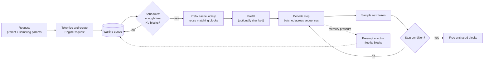

# LocalStrm

**A small, readable LLM inference engine for learning how vLLM works.**

Paged KV cache, continuous batching, prefix caching, chunked prefill, and preemption, implemented in plain PyTorch and small enough to read in a weekend.

[](INSTALL.md)
[](https://pytorch.org/)
[](tests)

---

## What this is (and isn't)

LocalStrm breaks LLM inference into the pieces a serving system is made of (request intake, scheduling, KV-cache memory management, model execution, sampling, and response delivery) and implements each as a separate, inspectable component with tests.


- **It is not** a fast engine. Attention uses standard PyTorch `scaled_dot_product_attention` on gathered KV blocks, not a fused paged-attention kernel, and there are no CUDA graphs. In some benchmarks below, plain Hugging Face batching beats it. That is expected, and the results are reported honestly.
- **It is not** production software. It targets a single GPU, and the server has no authentication.

If you want a fast engine, use [vLLM](https://github.com/vllm-project/vllm). If you want to understand why vLLM is designed the way it is, start here.

## Who it's for

Students and engineers who know roughly what a transformer is and want to answer questions like:

- Why does the KV cache cause memory fragmentation, and how does paging fix it?
- What does "continuous batching" change compared with normal batching?
- How can two requests share the same prompt prefix without recomputing it?
- What happens when the GPU runs out of KV blocks mid-generation?

---

## Quick start

Linux is the primary validated platform. Windows has limited testing and is supported on a best-effort basis. A CUDA GPU is recommended; the reference machine is an RTX 4050 laptop with 6 GB.

```bash
git clone https://github.com/SKrishna-7/localstrm.git
cd localstrm

python3.11 -m venv .venv
source .venv/bin/activate
python -m pip install --upgrade pip

# Install a CUDA build of PyTorch first: https://pytorch.org/get-started/locally/
python -m pip install -r requirements.txt

export PYTHONPATH=.
python cli.py --help
```

Check that a model fits **before** downloading it, then run it:

```bash
python cli.py check  --model Qwen/Qwen2.5-0.5B --device cuda

python cli.py engine --model Qwen/Qwen2.5-0.5B \
  --prompt "Explain virtual memory in two sentences." \
  --temperature 0.0
```

Platform details, dependency profiles, and troubleshooting are in [INSTALL.md](INSTALL.md).

---

## The 60-second mental model

1. **The KV cache is the memory problem.** Generating each token needs the keys and values of every previous token. That cache grows by one entry per token, and different requests end at different lengths. Reserving one big contiguous buffer per request wastes memory.
2. **Paging fixes the waste.** Split the cache into fixed-size blocks (16 tokens by default). A per-request *block table* maps logical positions to whichever physical blocks are free. Memory is allocated as needed and recycled when requests finish.
3. **Continuous batching fixes the idle slots.** In static batching, a batch runs until its slowest request finishes. Here the scheduler runs *one step at a time*: finished requests leave immediately and waiting requests join the next step.
4. **Prefix caching skips repeated work.** If two prompts start with the same tokens (a shared system prompt), their first blocks can be reused instead of recomputed.
5. **Preemption handles running out of blocks.** Under memory pressure, the engine frees a victim's blocks and recomputes it later instead of crashing.

```
Request A has 6 tokens, block_size = 4

logical positions :  [ t0 t1 t2 t3 ] [ t4 t5 .. .. ]
                        block 0         block 1
block table (A)   :  [ 7, 2 ]                          <- logical -> physical

physical KV pool  :  0  1  [2]  3  4  5  6  [7]  8 ...
                              A.b1             A.b0
```

### Life of a request



A request that can never fit in the pool fails instead of waiting forever.

---

## Where each idea lives in the code

Read in this order. Each step builds on the previous one.

| # | vLLM concept | What it does | File |
|---|---|---|---|
| 1 | Engine configuration | Block size, batch size, pool size, feature flags | `src/config.py` |
| 2 | Block manager | Block tables, free pool, allocation and release | `src/memory/block_manager.py` |
| 3 | Prefix caching | Reuses blocks whose content hash matches | `src/memory/prefix_cache.py` |
| 4 | Scheduler | Per-step admission and ordering of requests | `src/scheduler/continuous_scheduler.py` |
| 5 | Chunked prefill | Splits long prompts into per-step token budgets | `src/scheduler/chunked_prefill.py` |
| 6 | Preemption | Picks a victim, frees its blocks, recomputes later | `src/memory/preemption.py` |
| 7 | Model runner | Builds batched inputs, runs the forward pass | `src/engine/model_runner.py` |
| 8 | Paged attention | Gathers non-contiguous blocks, runs attention | `src/kernels/paged_attention.py` |
| 9 | Sampling | Greedy, temperature, top-p/top-k/min-p, penalties | `src/engine/sampling.py` |
| 10 | Engine loop | Ties scheduler, memory, and model together | `src/engine/llm_engine.py` |

**Extras** (not needed to understand vLLM's core ideas): quantization (`src/kernels/quantization.py`), the OpenAI-compatible server (`src/server/`), Prometheus metrics (`src/observability/metrics.py`), and the hardware preflight check (`src/memory/preflight.py`).


---


## Chat CLI: Choosing an Engine

LocalStrm's interactive chat CLI supports two execution backends: Hugging Face Transformers and the native LocalStrm inference engine. Choose a backend with the `--engine` argument.

### Hugging Face Transformers

Use the Hugging Face backend for broader model compatibility and the standard Transformers generation workflow.

```bash
python cli.py chat \
  --engine hf \
  --model Qwen/Qwen2.5-Coder-0.5B-Instruct
```

### Native LocalStrm Engine

Use the native engine to run interactive conversations through LocalStrm's inference pipeline, including its paged KV-cache management and scheduling architecture.

```bash
python cli.py chat \
  --engine localstrm \
  --model Qwen/Qwen2.5-Coder-0.5B-Instruct \
  --max-tokens 512
```

### Engine Comparison

| Feature | Hugging Face (`hf`) | LocalStrm (`localstrm`) |
|---|---|---|
| Generation path | Transformers generation API | Native LocalStrm inference loop |
| KV-cache management | Managed by the Transformers backend | Managed by LocalStrm's paged KV-cache system |
| Architecture compatibility | Broader compatibility, depending on model and dependencies | Focused on supported dense decoder-only transformer architectures |
| Scheduling | Depends on the selected Transformers workflow | Uses LocalStrm's native scheduling and continuous-batching architecture |
| Intended use | General-purpose interactive generation and model compatibility | Exploring and using LocalStrm's inference and memory-management features |

### Interactive Chat Features

The chat CLI supports the following features:

- **Multi-turn conversation:** Continue a conversation with the context of previous turns.
- **`/clear`:** Reset the conversation history.
- **`/stats`:** Display available engine and memory statistics.
- **`/exit`:** End the interactive session.
- **Stop-token handling:** Stop generation when configured stopping criteria are reached and avoid displaying stop tokens as normal output.
- **Maximum generation length:** Use `--max-tokens` to limit the number of generated tokens.

### Model Compatibility

The native LocalStrm engine currently targets supported dense decoder-only transformer architectures, such as compatible LLaMA- and Qwen2-style models. Unsupported architectures fail with an error rather than silently falling back to Hugging Face generation.

For models that are not supported by the native engine, use `--engine hf`, provided the model is compatible with your installed Transformers version and dependencies.

### Choosing the Right Backend

Use `hf` when compatibility with the broader Transformers ecosystem is your priority. Use `localstrm` when you want to exercise LocalStrm's own inference pipeline and KV-cache management.

The older `--engine mini-vllm` spelling remains available as a backward-compatible alias for `--engine localstrm`. Use `--engine localstrm` in new commands.

The native engine is not guaranteed to be faster for every model or workload. See [Experiments and Results](#experiments-and-results) for benchmark methodology, limitations, and recorded observations.

---
## Try the ideas yourself

Each command isolates one concept. The small numbers make the behavior easy to see.

| Concept | Command | What to look for |
|---|---|---|
| Continuous vs static batching | `python cli.py perf-benchmark --profile smoke` | The static baseline wastes sequence slots on finished requests; LocalStrm doesn't. |
| Prefix caching | `python cli.py prefix-cache --system-prompt "You are a Linux kernel expert." --query "How does kswapd work?" --query "Explain the buddy allocator."` | The second query reuses the shared prefix, so its time-to-first-token drops. |
| Preemption | `python cli.py preempt --total-blocks 5 --block-size 4` | With only 5 tiny blocks, requests get evicted and recomputed, yet all of them finish. |
| Chunked prefill | `python cli.py chunked-prefill --chunk-size 32` | A long arriving prompt no longer stalls a short request that is already decoding. |
| INT8 KV cache | `python cli.py engine --vram-budget 2GiB --kv-cache-dtype int8 --prompt "What is a page table?"` | More KV blocks fit in the same budget (at some speed and accuracy cost). |

---

## Experiments and results

All numbers come from a single machine: **RTX 4050 Laptop GPU (6 GB), PyTorch 2.13.0+cu132, CUDA 13.2, Python 3.11.15**, using `Qwen/Qwen2.5-0.5B` unless noted. The three studies used different prompts and measurement boundaries, so **don't compare them with each other**. The raw JSON and one-off experiment scripts aren't included in this repository; `perf-benchmark` runs supported comparable workloads. These are historical, hardware-specific observations, not performance guarantees. The mixed-arrival study above is explicitly limited to scheduler accounting because its arrival timestamps were not reliably enforced.

### 1. Why continuous batching exists (scheduling waste)

Mixed workload: 16 real prompts, generation targets of 16-36 tokens, and 3 repetitions per cell. The earlier benchmark harness did not reliably enforce request arrival timestamps, so arrival-time-sensitive TTFT/end-to-end latency and throughput conclusions from that run are not treated as validated results. The slot-waste figures below are provided only as a scheduler-accounting illustration, not as evidence of an overall performance win.

| Concurrency | HF static: wasted slots | LocalStrm: wasted slots |
|---:|---:|---:|
| 1 | 0.0% | 0.0% |
| 2 | 15.3% | 0.0% |
| 4 | 23.5% | 0.0% |
| 8 | 28.8% | 0.0% |
| 16 | 28.8% | 0.0% |

*Waste = inactive sequence-slot steps / (useful + inactive) slots.* It measures idle batch slots, not GPU idle time. Continuous batching has none **by construction**, so this table shows the idea, not an engineering win.

### 2. Concurrent serving vs a serial server

Fixed 16-token prompt, 32 output tokens, concurrency 1-6, streaming and non-streaming, 120 trials total.

| Concurrency (non-streaming) | HF serial | LocalStrm FP16 KV | Ratio |
|---:|---:|---:|---:|
| 1 | 63.21 tok/s | 68.20 tok/s | 1.08x |
| 2 | 66.69 tok/s | 121.66 tok/s | 1.82x |
| 4 | 51.43 tok/s | 228.33 tok/s | 4.44x |
| 6 | 62.76 tok/s | 178.76 tok/s | 2.85x |

Read this as "batching beats handling one request at a time", not "LocalStrm is 4x faster than Hugging Face". The baseline serves requests one by one, so at concurrency 4 the 10x lower time-to-first-token (103 ms vs 1,081 ms) is mostly queueing delay. Throughput peaked at concurrency 4 and fell at 6. INT8 KV was slower than FP16 in these runs because it trades speed for capacity.

### 3. Real-model quantization on a 6 GB GPU (Qwen2.5-3B)

This recorded real-model comparison used full `Qwen/Qwen2.5-3B` weights (5.74 GiB uncompressed safetensors, 36 layers, $d_{\text{model}}=2048$, $d_{\text{mlp}}=11008$), greedy decoding ($T=0.0$), a 9-token prompt, and 16 generated tokens. Timing boundaries used `torch.cuda.synchronize()` before and after execution steps.

| Metric | INT8 baseline (`--quant int8`) | Hybrid INT8 (`--quant hybrid_int8`) | Improvement / delta |
|---|---:|---:|---:|
| Decode throughput | 2.92 tok/s | 18.23 tok/s | 6.24x |
| Average decode latency | 342.60 ms/token | 54.87 ms/token | 6.24x lower latency |
| Steady-state decode latency (tokens 2-15) | 341.74 ms/token | 52.56 ms/token | 6.50x lower latency |
| End-to-end throughput, including prefill | 2.20 tok/s | 5.77 tok/s | 2.63x |
| Time to first token | 2,140.98 ms | 1,948.49 ms | 1.10x faster |
| Peak allocated VRAM | 3,483.1 MiB | 3,635.8 MiB | +152.8 MiB (+4.4%) |
| Output-token comparison | Baseline sequence | 12-token identical prefix | Diverged at token 13 (`\n` vs `.`) |

> **Scope:** This table reflects one recorded real-model run per mode, not a multi-run average. The reported speedups apply only to this workload and model. The output sequences diverged, and output quality was not evaluated; this is a performance comparison, not a claim of output parity. Independent hardware-counter verification of Tensor Core use was not performed.

### How to read these results

- One GPU, small models, short generations, 3-5 repetitions, no variance reported.
- Baselines are Hugging Face serial and static batching, not vLLM or other optimized engines.
- Treat them as demonstrations of *mechanisms*, not as performance claims.

---

## Preflight: check memory before downloading

`python cli.py check` estimates whether a model will fit **before** any weights are downloaded (`src/memory/preflight.py`). It reads only Hub metadata and `config.json` (about 3 KB), or file sizes for a local directory.

```bash
python cli.py check --model Qwen/Qwen2.5-3B --quant hybrid_int8 --device cuda
```

The report calculates the estimate from the selected model, quantization mode, current available resources, configured context/batch assumptions, and the engine's safety allowances. **Read the output produced on your own machine; do not rely on memory figures copied from another machine or an earlier run.**

What it checks:

- **GPU memory:** weights (scaled by quantization mode) + KV cache + runtime overhead, against free VRAM with a safety margin.
- **KV cache size:** `2 x layers x kv_heads x head_dim x bytes_per_element x context x batch`.
- **Host RAM:** quantized modes load FP16 weights into CPU RAM first, so RAM must hold them.
- **Disk:** checks that enough space is available for the model download, including the configured safety allowance.
- **Fail-closed:** if required metadata cannot be resolved, preflight exits with an error rather than silently guessing. `--force` bypasses the preflight guard.

It is an **estimate, not a guarantee**: activation memory varies with batch composition, and other GPU processes can still cause an out-of-memory error.

With `--vram-budget 2GiB` (instead of `--total-blocks`), the engine subtracts weights, overhead, workspace, and a safety margin from your budget and sizes the KV pool from what's left.


---

## Optional extras

### Quantization

| Flag | Meaning | Requirement |
|---|---|---|
| `--quant none` | No LocalStrm weight quantization; uses the model loader's configured floating-point dtype | Any supported device |
| `--quant int8` | W8A16: INT8 weights, FP16 activations | Any CUDA GPU |
| `--quant int4` | W4A16: INT4 weights, FP16 activations | Any CUDA GPU |
| `--quant hybrid_int8` | INT8 matmul for MLP layers only | Compute capability 8.0+ (Ampere or newer) and `torch._int_mm` |
| `--kv-cache-dtype int8` | INT8 KV cache with FP16 scales per token and KV head; roughly half the KV-cache storage of FP16 | CUDA |


Quantized models load in FP16 on the CPU, are quantized there, and only the compressed weights move to the GPU.

### OpenAI-compatible server

```bash
python -m pip install -r requirements-serving.txt

python cli.py serve --engine localstrm --model Qwen/Qwen2.5-0.5B --port 8000
```

```bash
curl http://127.0.0.1:8000/v1/chat/completions \
  -H "Content-Type: application/json" \
  -d '{"model": "Qwen/Qwen2.5-0.5B",
       "messages": [{"role": "user", "content": "What is a page table?"}],
       "max_tokens": 64}'
```

Endpoints: `POST /v1/chat/completions` (streaming via SSE), `POST /v1/completions`, `GET /v1/models`, `GET /health`, `GET /metrics` (Prometheus), `GET /docs`.

> **Security:** the server binds to `127.0.0.1` by default and has **no authentication**. Binding to `0.0.0.0` exposes it to your whole network. Don't do that on an untrusted network.

`--engine localstrm` selects LocalStrm's native engine; the default `hf` backend serves requests through Hugging Face instead. (`localstrm` and the `MiniVLLMEngine` class are the project's earlier name.)

#### VS Code with Continue

A small local setup verified during manual smoke testing used `Qwen/Qwen2.5-Coder-0.5B-Instruct` on an RTX 4050 laptop. The example below is a starting point, not a universal VRAM guarantee.

Start the server:

```bash
python cli.py serve \
  --engine localstrm \
  --model Qwen/Qwen2.5-Coder-0.5B-Instruct \
  --quant none \
  --kv-cache-dtype fp16 \
  --batch-size 1 \
  --total-blocks 128 \
  --port 8000
```

In Continue's `config.yaml`, configure the OpenAI-compatible provider:

```yaml
name: LocalStrm
version: 1.0.0
schema: v1

models:
  - name: LocalStrm Qwen Coder
    provider: openai
    model: Qwen/Qwen2.5-Coder-0.5B-Instruct
    apiBase: http://127.0.0.1:8000/v1
    apiKey: localstrm
    roles:
      - chat
      - edit
    defaultCompletionOptions:
      contextLength: 2048
      maxTokens: 512
      temperature: 0.2
```

Select **Chat** mode in Continue and begin with a short prompt. If the server reports KV-cache exhaustion or CUDA out-of-memory, reduce the context/output limits or the configured KV pool to fit the GPU; larger values are not automatically better. The server has no authentication, so keep it bound to localhost unless you add an authentication layer.

### Metrics

`python cli.py metrics --serve --port 9090` runs a workload while exposing Prometheus metrics (throughput, latency histograms, KV-cache utilization). This CLI workload is separate from the `/metrics` endpoint exposed by the OpenAI-compatible API server.

#### Prometheus and Grafana with Docker Compose

The repository's Docker Compose monitoring setup runs Prometheus and Grafana alongside the API server. The example configuration maps Prometheus to host port `9091` and Grafana to host port `3001` to avoid conflicting with services already using `9090` or `3000`.

1. Start the LocalStrm API server in one terminal:

   ```bash
   python cli.py serve \
     --engine localstrm \
     --model Qwen/Qwen2.5-0.5B \
     --host 0.0.0.0 \
     --port 8000
   ```

   The Prometheus container must be able to reach the host API at port `8000`. This example binds to all host interfaces, so use it only on a trusted development machine/network. The server has no authentication; do not expose it to an untrusted network.

2. From the repository root, start the monitoring stack in another terminal:

   ```bash
   docker compose up -d
   ```

   The Compose configuration should include `docker-compose.yml` and `monitoring/prometheus.yml`, with Prometheus scraping `host.docker.internal:8000` and the Docker host-gateway mapping configured for Linux. Check the target configuration if your local files differ.

3. Open the monitoring interfaces:

   - **Prometheus:** [http://localhost:9091](http://localhost:9091)
   - **Prometheus targets:** [http://localhost:9091/targets](http://localhost:9091/targets). The LocalStrm target should be `UP`.
   - **Grafana:** [http://localhost:3001](http://localhost:3001). Sign in using the credentials configured for your Compose service.

4. In Grafana, add Prometheus as a data source with the URL `http://prometheus:9090`, which is the service address inside the Compose network. Create dashboard panels using the metrics below or the query examples that follow.

#### Useful Prometheus metrics

| Metric | Meaning |
|---|---|
| `vllm_requests_completed_total` | Cumulative number of requests that completed normally. |
| `vllm_requests_failed_total` | Cumulative number of rejected, failed, or aborted requests, labelled by bounded `error_type`. |
| `vllm_prompt_tokens_total` | Prompt tokens accounted for across requests, including reused prefix tokens and completed prefill chunks for requests that fail or are aborted. This is an accounting counter, not a measure of newly computed tokens only. |
| `vllm_generation_tokens_total` | Generated output tokens accounted for, including output emitted before a request fails or is aborted. |
| `vllm_num_requests_running` / `vllm_num_requests_waiting` | Number of requests currently running and waiting for admission. |
| `vllm_gpu_cache_usage_factor` | Fraction of physical KV-cache blocks allocated, from `0.0` to `1.0`. |
| `vllm_gpu_cache_allocated_blocks` / `vllm_gpu_cache_total_blocks` | Allocated KV-cache blocks and total block capacity. |
| `vllm_prefix_cache_hit_rate` | Ratio of reused prefix tokens to total prompt tokens for the most recently recorded request; this gauge is not a cumulative hit counter. |
| `vllm_time_to_first_token_seconds` | Histogram of time from request arrival to first generated token, including queue wait. |
| `vllm_time_per_output_token_seconds` | Histogram of per-token decode latency. |
| `vllm_e2e_request_latency_seconds` | Histogram of end-to-end request latency. |

Example PromQL queries for dashboard panels:

```promql
# Completed requests per second, by model
sum by (model) (rate(vllm_requests_completed_total[5m]))

# Failed requests per second, by model and failure category
sum by (model, error_type) (rate(vllm_requests_failed_total[5m]))

# Generated output tokens per second, by model
sum by (model) (rate(vllm_generation_tokens_total[5m]))

# Current KV-cache utilization
vllm_gpu_cache_usage_factor

# 95th percentile time to first token, by model
histogram_quantile(0.95, sum by (le, model) (rate(vllm_time_to_first_token_seconds_bucket[5m])))
```

To stop the monitoring stack, run `docker compose down` from the repository root. Keep the monitoring services local to your development environment unless you have configured appropriate access controls.

---

## Command overview

| Command | Purpose |
|---|---|
| `engine` | Run prompts through LocalStrm's engine |
| `serve` | Start the OpenAI-compatible server |
| `check` | Memory and hardware preflight |
| `inspect` | Show model geometry and VRAM breakdown |
| `list-models` | List models in the local Hugging Face cache |
| `perf-benchmark`, `benchmark`, `stress-test` | Static vs continuous batching comparisons |
| `prefix-cache`, `preempt`, `chunked-prefill`, `quantize` | One-concept experiments |
| `metrics` | Workload plus Prometheus telemetry |
| `test` | Run the regression suite |
| `chat` | Interactive terminal chat using Hugging Face (`hf`, default) or the native LocalStrm engine (`localstrm`) via `--engine` |
Run `python cli.py <command> --help` for every flag. Defaults: model `Qwen/Qwen2.5-0.5B` (or `$MODEL_ID`), device auto-detected (or `$ENGINE_DEVICE`).

---

## How LocalStrm differs from vLLM

| Area | vLLM | LocalStrm |
|---|---|---|
| Attention | Fused paged-attention / FlashAttention-style kernels | Gather blocks, then PyTorch SDPA |
| Execution | CUDA graphs, heavily optimized runtime | Eager PyTorch |
| Scale | Multi-GPU and multi-node (tensor/pipeline parallelism) | Single GPU |
| Models | Many architectures | Dense decoder-only models in the LLaMA/Qwen2 style (RMSNorm, RoPE, GQA) |
| Prefix cache | Hash-based block cache | Hash-based block cache with chained SHA-256 hashes |
| Not implemented here | | Speculative decoding, LoRA, multimodal inputs, tensor parallelism |


The *concepts* (block tables, iteration-level scheduling, hash-based prefix reuse, and recompute preemption) are inspired by the same serving ideas used in vLLM. This is not a claim of feature or performance parity.

---

## Tests

240 tests across 19 modules (`pytest tests/ --collect-only -q`). The latest recorded verification completed all 240 tests: 229 offline tests and 11 model-dependent tests.

```bash
export PYTHONPATH=.

# Offline tier: 16 modules, no internet or model download needed
pytest tests/test_all_features.py tests/test_api_server.py tests/test_cli_reliability.py \
       tests/test_cli_serving.py tests/test_gqa_generalization.py tests/test_http_serving.py \
       tests/test_hybrid_int8.py tests/test_memory_constrained.py tests/test_metrics_lifecycle.py \
       tests/test_preflight.py tests/test_quantized_loader.py tests/test_reliability.py \
       tests/test_sampling_parity.py tests/test_scheduler_transitions.py \
       tests/test_serving_adapter.py tests/test_vram_budget.py -v

# Model-dependent tier: 3 modules, need Qwen/Qwen2.5-0.5B cached locally
pytest tests/test_batched_runner.py tests/test_int8_long_context.py tests/test_int8_multi_step.py -v
```

Latest recorded results: 229 tests passed in the offline tier (16 modules), and 11 tests passed in the model-dependent tier (3 modules) using cached `Qwen/Qwen2.5-0.5B`. Across both tiers, 240 passed, 0 failed, and 0 skipped. The offline tier uses synthetic tensors and mocks; the model-dependent tier adds checks that run against real model weights. Both sets of commands are shown above. The recorded runs included warnings, so a passing test count does not mean the test run was warning-free.

---

## Limitations

- **Single GPU only:** Tensor parallelism and pipeline parallelism across multiple GPUs are not supported.
- **Native engine model support:** Supports compatible dense, decoder-only transformer architectures following the LLaMA/Qwen2-style layout. Individual models require validation. Hybrid convolution/state-space architectures, such as Liquid LFM3, are not supported by the native engine.
- **Numerical differences:** Batched decoding can change floating-point reduction order, so greedy outputs may differ from isolated, serial Hugging Face runs. Set `batched_decode=False` to use the serial path for numerical checks.
- **Server reliability:** Thread-safe request submission is supported, but recovery from unrecoverable CUDA errors is not guaranteed.
- **Quantization:** Hybrid INT8 quantization can change generated outputs. Its output quality has not yet been comprehensively evaluated.
- **Attention performance:** LocalStrm gathers non-contiguous KV-cache blocks into contiguous tensors before applying PyTorch SDPA. It does not yet use a fused native paged-attention kernel or CUDA Graphs, so performance may be lower than Hugging Face for some workloads.

## FAQ

### Why can LocalStrm be slower than Hugging Face?

The native engine currently gathers scattered KV-cache blocks into contiguous tensors before running attention. This introduces memory movement, temporary allocations, and execution overhead. A fused paged-attention kernel could reduce these costs, but it has not yet been implemented.

### Why did preflight report `PASS` if inference ran out of memory?

Preflight estimates memory requirements, but it cannot account for every activation-memory fluctuation or other processes using the GPU.

If inference runs out of memory, try:

- Reducing the batch size or maximum number of concurrent requests.
- Lowering the KV-cache allocation.
- Shortening the context length.
- Using a quantized configuration.

#### Why might generated output differ between engines?

Different batching strategies and floating-point reduction orders can produce different token sequences, even with the same model weights and sampling settings. When investigating numerical differences, compare both engines using equivalent decoding configurations.

#### What if my model architecture is unsupported by LocalStrm?

Use the Hugging Face backend if the model is compatible with your installed Transformers version and its dependencies. The native engine should report an error for unsupported architectures rather than silently falling back to another generation path.

#### Does continuous batching guarantee higher throughput?

No. Continuous batching can improve GPU utilization when requests overlap, but actual throughput depends on concurrency, prompt and output lengths, model size, available GPU resources, and implementation overhead.

Use reproducible benchmarks across representative workloads before drawing performance conclusions.

## Current project status

LocalStrm is an experimental, single-GPU inference engine for studying LLM serving internals. The list below separates implemented capabilities from work that has not yet been implemented.

**Implemented and available to experiment with:**

- Paged KV-cache block management, continuous batching, prefix caching, chunked prefill, and preemption/recomputation.
- INT8 KV-cache storage and the documented weight-quantization paths.
- OpenAI-compatible API serving, streaming responses, and Prometheus metrics.
- Model/VRAM preflight checks and regression tests for memory, scheduling, serving, and request lifecycle behavior.

**Not implemented yet:**

- A fused native paged-attention kernel; the current attention path gathers KV blocks before calling PyTorch SDPA.
- CUDA Graphs for decode execution.
- Multi-GPU tensor or pipeline parallelism.

Performance optimization and broader model compatibility remain ongoing work. See [Limitations](#limitations) and [Ideas for what to build next](#ideas-for-what-to-build-next) for more detail.

## Ideas for what to build next

Good first extensions if you want to learn by changing the code:

- A `--trace` mode that prints per-step scheduler decisions and block tables.
- Invariant tests for the block manager (blocks never leak, ref counts return to zero).
- Swapping the gather-plus-SDPA path for a Triton kernel, or adding CUDA graphs for decode.
- AWQ/GPTQ 4-bit execution and speculative decoding.

## License

MIT. See [LICENSE](LICENSE).

## Acknowledgements

Built to study the ideas of the [vLLM](https://github.com/vllm-project/vllm) project and the PagedAttention paper. Uses [PyTorch](https://pytorch.org/), [Hugging Face Transformers](https://github.com/huggingface/transformers), and [FastAPI](https://fastapi.tiangolo.com/). Example models are from the Qwen team.
