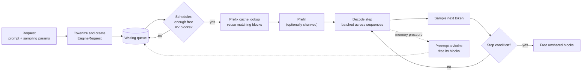

# LocalStrm

**A small, readable LLM inference engine for learning how vLLM works.**

Paged KV cache, continuous batching, prefix caching, chunked prefill, and preemption, implemented in plain PyTorch and small enough to read in a weekend.

[](INSTALL.md)
[](https://pytorch.org/)
[](tests)
[](LICENSE)

---

## What this is (and isn't)

LocalStrm breaks LLM inference into the pieces a serving system is made of (request intake, scheduling, KV-cache memory management, model execution, sampling, and response delivery) and implements each as a separate, inspectable component with tests.

- **It is** a learning project. Every major idea from vLLM has a matching file you can open and read.
- **It is not** a fast engine. Attention uses standard PyTorch `scaled_dot_product_attention` on gathered KV blocks, not a fused paged-attention kernel, and there are no CUDA graphs. In some benchmarks below, plain Hugging Face batching beats it. That is expected, and the results are reported honestly.
- **It is not** production software. It targets a single GPU, and the server has no authentication.

If you want a fast engine, use [vLLM](https://github.com/vllm-project/vllm). If you want to understand why vLLM is designed the way it is, start here.

## Who it's for

Students and engineers who know roughly what a transformer is and want to answer questions like:

- Why does the KV cache cause memory fragmentation, and how does paging fix it?
- What does "continuous batching" change compared with normal batching?
- How can two requests share the same prompt prefix without recomputing it?
- What happens when the GPU runs out of KV blocks mid-generation?

---

## Quick start

Linux is verified. Windows is untested (best effort). A CUDA GPU is recommended; the reference machine is an RTX 4050 laptop with 6 GB.

```bash
git clone https://github.com/SKrishna-7/localstrm.git
cd localstrm

python3.11 -m venv .venv
source .venv/bin/activate
python -m pip install --upgrade pip

# Install a CUDA build of PyTorch first: https://pytorch.org/get-started/locally/
python -m pip install -r requirements.txt

export PYTHONPATH=.
python cli.py --help
```

Check that a model fits **before** downloading it, then run it:

```bash
python cli.py check  --model Qwen/Qwen2.5-0.5B --device cuda

python cli.py engine --model Qwen/Qwen2.5-0.5B \
  --prompt "Explain virtual memory in two sentences." \
  --temperature 0.0
```

Platform details, dependency profiles, and troubleshooting are in [INSTALL.md](INSTALL.md).

---

## The 60-second mental model

1. **The KV cache is the memory problem.** Generating each token needs the keys and values of every previous token. That cache grows by one entry per token, and different requests end at different lengths. Reserving one big contiguous buffer per request wastes memory.
2. **Paging fixes the waste.** Split the cache into fixed-size blocks (16 tokens by default). A per-request *block table* maps logical positions to whichever physical blocks are free. Memory is allocated as needed and recycled when requests finish.
3. **Continuous batching fixes the idle slots.** In static batching, a batch runs until its slowest request finishes. Here the scheduler runs *one step at a time*: finished requests leave immediately and waiting requests join the next step.
4. **Prefix caching skips repeated work.** If two prompts start with the same tokens (a shared system prompt), their first blocks can be reused instead of recomputed.
5. **Preemption handles running out of blocks.** Under memory pressure, the engine frees a victim's blocks and recomputes it later instead of crashing.

```
Request A has 6 tokens, block_size = 4

logical positions :  [ t0 t1 t2 t3 ] [ t4 t5 .. .. ]
                        block 0         block 1
block table (A)   :  [ 7, 2 ]                          <- logical -> physical

physical KV pool  :  0  1  [2]  3  4  5  6  [7]  8 ...
                              A.b1             A.b0
```

### Life of a request



A request that can never fit in the pool fails instead of waiting forever.

---

## Where each idea lives in the code

Read in this order. Each step builds on the previous one.

| # | vLLM concept | What it does | File |
|---|---|---|---|
| 1 | Engine configuration | Block size, batch size, pool size, feature flags | `src/config.py` |
| 2 | Block manager | Block tables, free pool, allocation and release | `src/memory/block_manager.py` |
| 3 | Prefix caching | Reuses blocks whose content hash matches | `src/memory/prefix_cache.py` |
| 4 | Scheduler | Per-step admission and ordering of requests | `src/scheduler/continuous_scheduler.py` |
| 5 | Chunked prefill | Splits long prompts into per-step token budgets | `src/scheduler/chunked_prefill.py` |
| 6 | Preemption | Picks a victim, frees its blocks, recomputes later | `src/memory/preemption.py` |
| 7 | Model runner | Builds batched inputs, runs the forward pass | `src/engine/model_runner.py` |
| 8 | Paged attention | Gathers non-contiguous blocks, runs attention | `src/kernels/paged_attention.py` |
| 9 | Sampling | Greedy, temperature, top-p/top-k/min-p, penalties | `src/engine/sampling.py` |
| 10 | Engine loop | Ties scheduler, memory, and model together | `src/engine/llm_engine.py` |

**Extras** (not needed to understand vLLM's core ideas): quantization (`src/kernels/quantization.py`), the OpenAI-compatible server (`src/server/`), Prometheus metrics (`src/observability/metrics.py`), and the hardware preflight check (`src/memory/preflight.py`).

<!-- VERIFY: confirm every path and one-line description in this table against the actual files. -->

---

## Try the ideas yourself

Each command isolates one concept. The small numbers make the behavior easy to see.

| Concept | Command | What to look for |
|---|---|---|
| Continuous vs static batching | `python cli.py perf-benchmark --profile smoke` | The static baseline wastes sequence slots on finished requests; LocalStrm doesn't. |
| Prefix caching | `python cli.py prefix-cache --system-prompt "You are a Linux kernel expert." --query "How does kswapd work?" --query "Explain the buddy allocator."` | The second query reuses the shared prefix, so its time-to-first-token drops. |
| Preemption | `python cli.py preempt --total-blocks 5 --block-size 4` | With only 5 tiny blocks, requests get evicted and recomputed, yet all of them finish. |
| Chunked prefill | `python cli.py chunked-prefill --chunk-size 32` | A long arriving prompt no longer stalls a short request that is already decoding. |
| INT8 KV cache | `python cli.py engine --vram-budget 2GiB --kv-cache-dtype int8 --prompt "What is a page table?"` | More KV blocks fit in the same budget (at some speed and accuracy cost). |

---

## Experiments and results

All numbers come from a single machine: **RTX 4050 Laptop GPU (6 GB), PyTorch 2.13.0+cu132, CUDA 13.2, Python 3.11.15**, using `Qwen/Qwen2.5-0.5B` unless noted. The three studies used different prompts and measurement boundaries, so **don't compare them with each other**. The raw JSON and one-off experiment scripts aren't included in this repository; `perf-benchmark` runs comparable workloads.

### 1. Why continuous batching exists (scheduling waste)

Mixed workload: 16 real prompts, generation targets of 16-36 tokens, staggered arrivals, 3 repetitions per cell.

| Concurrency | HF static: wasted slots | LocalStrm: wasted slots |
|---:|---:|---:|
| 1 | 0.0% | 0.0% |
| 2 | 15.3% | 0.0% |
| 4 | 23.5% | 0.0% |
| 8 | 28.8% | 0.0% |
| 16 | 28.8% | 0.0% |

*Waste = inactive sequence-slot steps / (useful + inactive) slots.* It measures idle batch slots, not GPU idle time. Continuous batching has none **by construction**, so this table shows the idea, not an engineering win.

**Speed was not better.** In the same experiment HF static batching reached higher raw throughput at most concurrency levels (for example 262.5 vs 112.0 tok/s at concurrency 16). Removing wasted slots doesn't help if each step costs more. In LocalStrm each decode step gathers KV blocks into contiguous tensors before attention, and that copy is exactly what a fused paged-attention kernel avoids.

### 2. Concurrent serving vs a serial server

Fixed 16-token prompt, 32 output tokens, concurrency 1-6, streaming and non-streaming, 120 trials total.

| Concurrency (non-streaming) | HF serial | LocalStrm FP16 KV | Ratio |
|---:|---:|---:|---:|
| 1 | 63.21 tok/s | 68.20 tok/s | 1.08x |
| 2 | 66.69 tok/s | 121.66 tok/s | 1.82x |
| 4 | 51.43 tok/s | 228.33 tok/s | 4.44x |
| 6 | 62.76 tok/s | 178.76 tok/s | 2.85x |

Read this as "batching beats handling one request at a time", not "LocalStrm is 4x faster than Hugging Face". The baseline serves requests one by one, so at concurrency 4 the 10x lower time-to-first-token (103 ms vs 1,081 ms) is mostly queueing delay. Throughput peaked at concurrency 4 and fell at 6. INT8 KV was slower than FP16 in these runs because it trades speed for capacity.

### 3. Quantized decode on a 6 GB GPU (Qwen2.5-3B)

| Metric (16 prompts x 3 reps, 16 tokens) | Dynamic INT8 | Hybrid INT8 |
|---|---:|---:|
| Decode throughput | 3.07 tok/s | 9.72 tok/s |
| Peak allocated VRAM | 3,486.7 MiB | 3,641.5 MiB |

Hybrid INT8 keeps attention projections in FP16 and runs the MLP projections through integer matmul (`torch._int_mm`). It was about 3.2x faster than the dynamic-INT8 path here, but only **9 of 48** paired outputs matched token for token, and **output quality was not evaluated**. Tensor Core usage was not verified with hardware counters.

### How to read these results

- One GPU, small models, short generations, 3-5 repetitions, no variance reported.
- Baselines are Hugging Face serial and static batching, not vLLM or other optimized engines.
- Treat them as demonstrations of *mechanisms*, not as performance claims.

---

## Preflight: check memory before downloading

`python cli.py check` estimates whether a model will fit **before** any weights are downloaded (`src/memory/preflight.py`). It reads only Hub metadata and `config.json` (about 3 KB), or file sizes for a local directory.

```bash
python cli.py check --model Qwen/Qwen2.5-3B --quant hybrid_int8 --device cuda
```

```
Model: Qwen/Qwen2.5-3B | Device: cuda (NVIDIA GeForce RTX 4050 Laptop GPU)
Quantization Precision: hybrid_int8
[PROJECTED MEMORY CONSUMPTION]
  Model Compressed Weights: ~3.16 GiB
  KV-Cache Footprint:       ~0.25 GiB (batch=1, context=2048)
  CUDA Runtime Overhead:    ~0.80 GiB
  Total Projected VRAM:     ~4.21 GiB
[STATUS] PASS: Model is projected to fit safely in GPU VRAM.
```

What it checks:

- **GPU memory:** weights (scaled by quantization mode) + KV cache + runtime overhead, against free VRAM with a safety margin.
- **KV cache size:** `2 x layers x kv_heads x head_dim x bytes_per_element x context x batch`.
- **Host RAM:** quantized modes load FP16 weights into CPU RAM first, so RAM must hold them.
- **Disk:** free space for the download plus a 10% buffer.
- **Fail-closed:** if metadata can't be resolved, it exits with code 1 instead of guessing. `--force` overrides.

It is an **estimate, not a guarantee**: activation memory varies with batch composition, and other GPU processes can still cause an out-of-memory error.

With `--vram-budget 2GiB` (instead of `--total-blocks`), the engine subtracts weights, overhead, workspace, and a safety margin from your budget and sizes the KV pool from what's left.

<!-- VERIFY: the margin/overhead numbers here must match the constants in preflight.py after the consistency fix. -->

---

## Optional extras

### Quantization

| Flag | Meaning | Requirement |
|---|---|---|
| `--quant none` | FP16/BF16 weights | Any CUDA GPU or CPU |
| `--quant int8` | W8A16: INT8 weights, FP16 activations | Any CUDA GPU |
| `--quant int4` | W4A16: INT4 weights, FP16 activations | Any CUDA GPU |
| `--quant hybrid_int8` | INT8 matmul for MLP layers only | Compute capability 8.0+ (Ampere or newer) and `torch._int_mm` |
| `--kv-cache-dtype int8` | INT8 KV cache with FP16 scales (per token and head); roughly half the KV memory | Any CUDA GPU |

<!-- VERIFY: INT8 KV scale granularity (per-token-per-head per the pool layout) against src/kernels/quantization.py. -->

Quantized models load in FP16 on the CPU, are quantized there, and only the compressed weights move to the GPU.

### OpenAI-compatible server

```bash
python -m pip install -r requirements-serving.txt

python cli.py serve --engine mini-vllm --model Qwen/Qwen2.5-0.5B --port 8000
```

```bash
curl http://127.0.0.1:8000/v1/chat/completions \
  -H "Content-Type: application/json" \
  -d '{"model": "Qwen/Qwen2.5-0.5B",
       "messages": [{"role": "user", "content": "What is a page table?"}],
       "max_tokens": 64}'
```

Endpoints: `POST /v1/chat/completions` (streaming via SSE), `POST /v1/completions`, `GET /v1/models`, `GET /health`, `GET /metrics` (Prometheus), `GET /docs`.

> **Security:** the server binds to `127.0.0.1` by default and has **no authentication**. Binding to `0.0.0.0` exposes it to your whole network. Don't do that on an untrusted network.

`--engine mini-vllm` selects LocalStrm's engine; the default `hf` backend serves one request at a time through Hugging Face. (`mini-vllm` and the `MiniVLLMEngine` class are the project's earlier name.)

### Metrics

`python cli.py metrics --serve --port 9090` runs a workload while exposing Prometheus metrics (throughput, latency histograms, KV-cache utilization).

---

## Command overview

| Command | Purpose |
|---|---|
| `engine` | Run prompts through LocalStrm's engine |
| `serve` | Start the OpenAI-compatible server |
| `check` | Memory and hardware preflight |
| `inspect` | Show model geometry and VRAM breakdown |
| `list-models` | List models in the local Hugging Face cache |
| `perf-benchmark`, `benchmark`, `stress-test` | Static vs continuous batching comparisons |
| `prefix-cache`, `preempt`, `chunked-prefill`, `quantize` | One-concept experiments |
| `metrics` | Workload plus Prometheus telemetry |
| `test` | Run the regression suite |
| `chat` | Interactive terminal chat (uses Hugging Face generation, **not** LocalStrm's engine) |

Run `python cli.py <command> --help` for every flag. Defaults: model `Qwen/Qwen2.5-0.5B` (or `$MODEL_ID`), device auto-detected (or `$ENGINE_DEVICE`).

---

## How LocalStrm differs from vLLM

| Area | vLLM | LocalStrm |
|---|---|---|
| Attention | Fused paged-attention / FlashAttention-style kernels | Gather blocks, then PyTorch SDPA |
| Execution | CUDA graphs, heavily optimized runtime | Eager PyTorch |
| Scale | Multi-GPU and multi-node (tensor/pipeline parallelism) | Single GPU |
| Models | Many architectures | Dense decoder-only models in the LLaMA/Qwen2 style (RMSNorm, RoPE, GQA) |
| Prefix cache | Hash-based block cache | Hash-based block cache with chained SHA-256 hashes |
| Not implemented here | | Speculative decoding, LoRA, multimodal inputs, tensor parallelism |

<!-- VERIFY: prefix cache is described as chained SHA-256 hashing. If src/memory/prefix_cache.py is truly a radix tree, change this row and the "60-second mental model" bullet. -->

The *concepts* (block tables, iteration-level scheduling, hash-based prefix reuse, recompute preemption) are the same ones vLLM uses. This is not a claim of feature or performance parity.

---

## Tests

193 tests across 19 modules (`pytest tests/ --collect-only -q`).

```bash
export PYTHONPATH=.

# Offline tier: 16 modules, no internet or model download needed
pytest tests/test_all_features.py tests/test_api_server.py tests/test_cli_reliability.py \
       tests/test_cli_serving.py tests/test_gqa_generalization.py tests/test_http_serving.py \
       tests/test_hybrid_int8.py tests/test_memory_constrained.py tests/test_metrics_lifecycle.py \
       tests/test_preflight.py tests/test_quantized_loader.py tests/test_reliability.py \
       tests/test_sampling_parity.py tests/test_scheduler_transitions.py \
       tests/test_serving_adapter.py tests/test_vram_budget.py -v

# Model-dependent tier: 3 modules, need Qwen/Qwen2.5-0.5B cached locally
pytest tests/test_batched_runner.py tests/test_int8_long_context.py tests/test_int8_multi_step.py -v
```

In the last verified offline run, 182 tests passed and the 11 model-dependent tests were not executed because the checkpoint wasn't cached. The offline tier uses synthetic tensors and mocks, so end-to-end checks on real weights come from the model-dependent tier.

---

## Limitations

- **Single GPU only.** No tensor or pipeline parallelism.
- **Supported models:** decoder-only LLaMA/Qwen2-style architectures. End-to-end GPU validation used `Qwen/Qwen2.5-0.5B`; other compatible models need individual validation. T5, Bloom, Falcon, GPT-2, and mixture-of-experts models aren't supported by `--engine mini-vllm` (use `--engine hf`).
- **Numerics:** batched decoding can change floating-point reduction order, so greedy output may differ from isolated serial Hugging Face runs. `batched_decode=False` gives a serial path for numerical checks.
- **Server:** thread-safe submission is an MVP. Recovery from unrecoverable CUDA errors isn't guaranteed.
- **Quantization:** hybrid INT8 changes outputs and its quality isn't evaluated.

## FAQ

**Why is it sometimes slower than plain Hugging Face?** Each decode step copies scattered KV blocks into contiguous tensors, and the engine runs in eager PyTorch. Real systems fuse that into a custom kernel. That cost is the price of keeping every step readable.

**Why does `chat` use Hugging Face?** It's a quick terminal REPL for trying prompts. Use `engine` or `serve --engine mini-vllm` to exercise LocalStrm's own engine.

**The preflight said PASS but I got an out-of-memory error.** Preflight estimates; it can't see other processes or dynamic activation memory. Lower the batch size, set `--vram-budget`, or use a quantized mode.

**`ModuleNotFoundError: No module named 'src'`?** Run `export PYTHONPATH=.` from the repository root.

## License

MIT. See [LICENSE](LICENSE).

## Acknowledgements

Built to study the ideas of the [vLLM](https://github.com/vllm-project/vllm) project and the PagedAttention paper. Uses [PyTorch](https://pytorch.org/), [Hugging Face Transformers](https://github.com/huggingface/transformers), and [FastAPI](https://fastapi.tiangolo.com/). Example models are from the Qwen team.
